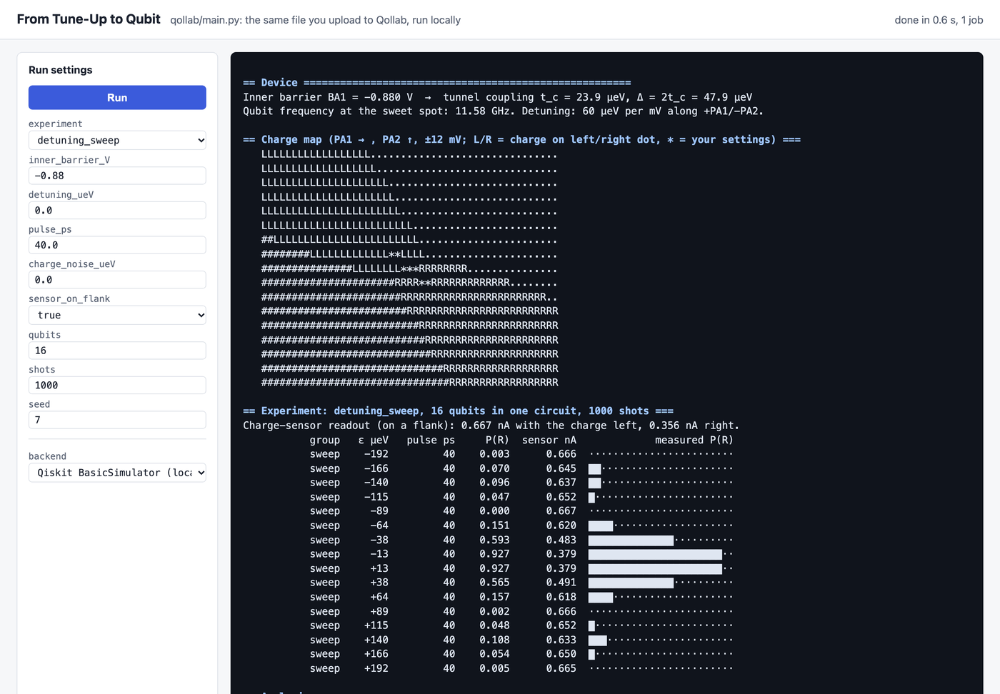
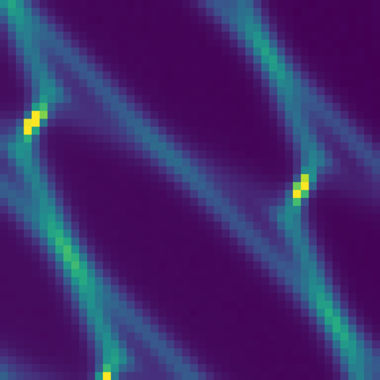
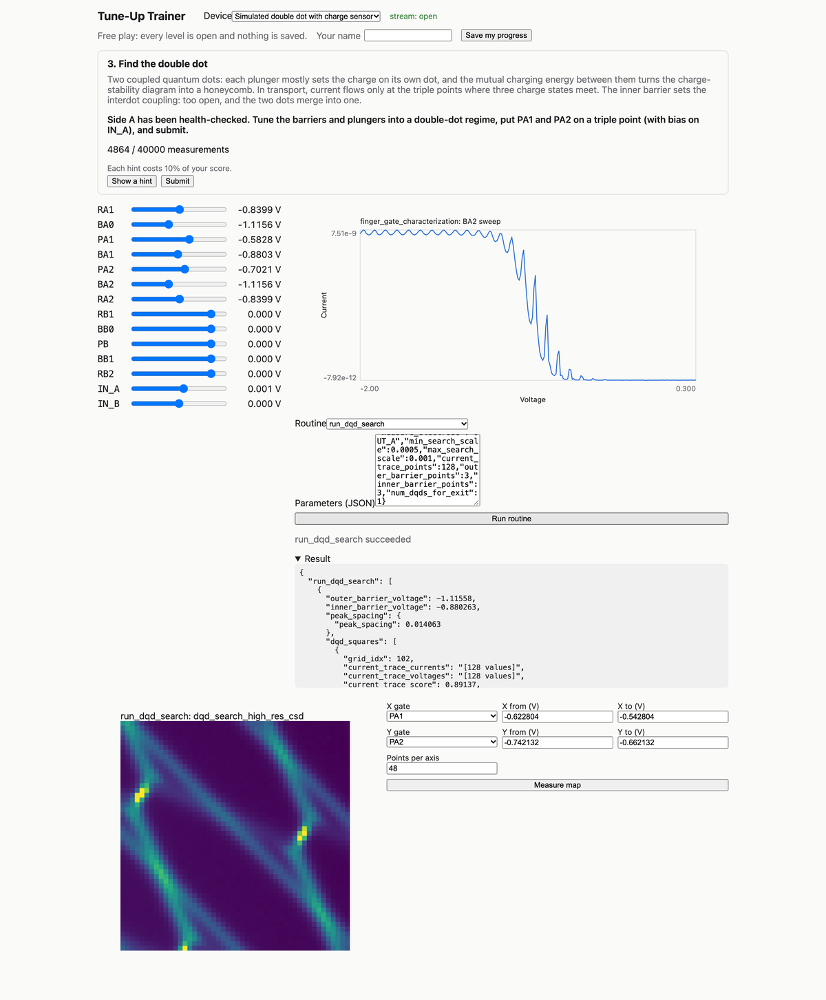

# mr.quantum: From Tune-Up to Qubit

**Tune a semiconductor double quantum dot the way a real lab does, then run that same device as a charge qubit in Qiskit.**

Before a spin or charge qubit can compute anything, someone has to *find* it: sweep gates, locate Coulomb peaks, park a charge sensor, compensate cross-talk and spot a double dot in a honeycomb charge-stability diagram. Tutorials teach qubits as abstract two-level systems and skip that whole step. mr.quantum connects the two. The gate voltages a student learns to set become the parameters of a Qiskit circuit, and the qubit's behaviour (resonance width, frequency, sweet-spot protection, readout contrast) is explained through those tune-up choices.

Built for the **Qollab × IonQ hackathon**, theme **Quantum Unlocked**.

> 🎬 **Demo video:** _link coming soon_

| Run the double dot as a qubit (`qollab/`, Qiskit) | Tune the device first (Tune-Up Trainer) |
|---|---|
|  |  |

## What's in this repo

| Part | What it is | Status |
|---|---|---|
| [`qollab/`](qollab/) | **The hackathon submission.** A Qiskit project that runs on Qollab's free simulators, including IonQ's. It turns the trainer's double dot into a charge qubit and runs three experiments. | Built during the hackathon |
| `trainer/`, `frontend/`, `stanza/drivers/simulator.py` | **The Stanza Tune-Up Trainer.** A physics simulator for gate-defined quantum dots, a FastAPI service and a React game with three levels, driven by the real upstream Stanza routines. | Prior work, disclosed below |
| `stanza/` | [Stanza](https://github.com/conductorquantum/stanza) by Conductor Quantum, the tune-up framework this repo forks. Its original README is in [`docs/STANZA.md`](docs/STANZA.md). | Upstream, MIT |

## The Qollab project (`qollab/`)

The double dot's two lowest charge states, |L⟩ (charge on the left dot) and |R⟩ (right dot), form a qubit:

**H = (ε σz + Δ σx) / 2**

The detuning ε is set by the plunger gates PA1 and PA2. The tunnel splitting Δ = 2 t_c is set by the inner barrier BA1. Both come from the same device model the trainer simulates.

| Experiment | What the run shows |
|---|---|
| `detuning_sweep` | A fixed pulse at many detunings. The charge only crosses near ε = 0, and the width of that resonance is Δ. The run fits Δ back out of the counts. |
| `time_sweep` | Longer and longer pulses. The charge oscillates between the dots at Ω/h = √(ε² + Δ²)/h, the qubit frequency. The run fits it. |
| `sweet_spot` | Frozen charge noise on every qubit, half at ε = 0 and half off it. At the sweet spot the frequency barely moves; off it, it shifts an order of magnitude more. |

**One circuit, one job.** Every setting in a sweep is its own independent qubit, so a whole experiment is a single circuit and a single `backend.run`. That fits IonQ's one-job-per-run limit on Qollab.

A pulse of length τ is a rotation by θ = Ωτ/ħ about the axis (Δ, 0, ε)/Ω, built as `Ry(φ) Rz(θ) Ry(−φ)`. The tests check every qubit's exact statevector against P(R) = (Δ/Ω)² sin²(θ/2).

**Run it on Qollab:** open the project page, press **Run on Qollab**, pick *Built-in simulator* or IonQ's simulator, then press **Run**. All settings are in **Run settings**. The full project page with things to try is [`qollab/README.md`](qollab/README.md).

**Run it locally:**

```bash
cd qollab
pip install -r requirements.txt
python -c "from main import main; main()"
python -c "from main import main; main(experiment='sweet_spot', pulse_ps=300, charge_noise_ueV=15)"
```

## The Tune-Up Trainer (prior work)



Students drive a simulated device through the actual upstream Stanza routines: health checks, `find_sensor_peak`, `run_compensation`, `run_dqd_search`. The simulator is qualitatively faithful: Coulomb blockade, pinch-off curves, cross-capacitance, honeycomb charge-stability diagrams and noise. Every level states the physical concept it teaches and is scored on the physics outcome.

1. **Find the Coulomb peak**: Coulomb blockade and charge sensing.
2. **Compensate the sensor**: cross-capacitance between gates.
3. **Find the double dot**: the honeycomb and its triple points.

```bash
make venv install     # uv-managed Python 3.12 venv, Python and frontend dependencies
make demo-04          # API on :8765 and the UI on http://127.0.0.1:5173
make verify           # the gate: lint, types, all tests, regression, frontend and e2e
```

## Hackathon disclosure

- **Built during the window (2026-10-09 19:00 ET to 2026-10-11 19:00 ET):** everything in `qollab/` and `tests/qollab/`, the demo tooling in `scripts/demo/`, this README, and a render-loop fix in the trainer's frontend.
- **Prior work (before 2026-10-09 19:00 ET):** the Stanza Tune-Up Trainer, built on Stanza by Conductor Quantum (MIT). The Qollab project reuses only its device parameters and barrier turn-on model, copied into `qollab/dqd.py`.
- **AI tools:** written with Claude Code (Anthropic) and reviewed and tested by the author.

## Reproducing the demo video

```bash
make demo-04 &                                   # trainer API and UI
.venv/bin/python scripts/demo/console_server.py & # runs qollab/main.py on demand
node scripts/demo/record.mjs out/                # one continuous take with captions
```

## License

MIT (see [`LICENSE`](LICENSE) and [`qollab/LICENSE`](qollab/LICENSE)). Stanza is © 2025 Conductor Quantum, MIT License.

This effort is supported by Qollab & IonQ
